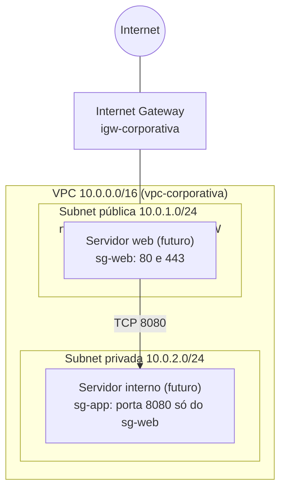

# AWS Cloud Networking com Terraform

[](https://github.com/Vitor-ux21/aws-infra-corporativa/actions/workflows/terraform.yml)

Laboratório de **cloud networking** na AWS: planejamento de endereçamento, roteamento, segmentação e controle de acesso de uma VPC, provisionado com Terraform. Projeto de estudo, 100% gratuito: nenhum recurso é criado na AWS.

## Arquitetura



| Componente | Valor |
|---|---|
| VPC | 10.0.0.0/16 |
| Subnet pública | 10.0.1.0/24 (rota padrão pelo Internet Gateway) |
| Subnet privada | 10.0.2.0/24 (somente rota local, sem saída para a internet) |
| Security Group web | Entrada 80 e 443 de qualquer origem; saída restrita a 80, 443 e à porta da aplicação |
| Security Group app | Entrada na porta 8080 somente do SG web |
| NACL privada | Stateless; permite somente a aplicação (8080) vinda da subnet pública e as respostas |

## Estrutura do repositório

```
.
├── README.md
├── .github/workflows/terraform.yml   # CI: fmt, validate e Checkov
├── docs/
│   ├── 01-plano-de-enderecamento.md
│   ├── 03-tabelas-de-roteamento.md
│   ├── 04-matriz-de-conectividade.md
│   └── 05-analise-de-seguranca-checkov.md
└── terraform/
    ├── versions.tf    # versão do Terraform e do provider
    ├── variables.tf   # CIDRs, região, zona de disponibilidade
    ├── main.tf        # VPC, subnets, IGW e route tables
    ├── security.tf    # Security Groups e NACL
    └── outputs.tf     # IDs dos recursos
```

## Documentação

- [Plano de endereçamento](docs/01-plano-de-enderecamento.md)
- [Tabelas de roteamento](docs/03-tabelas-de-roteamento.md)
- [Matriz de conectividade](docs/04-matriz-de-conectividade.md)
- [Análise de segurança com Checkov](docs/05-analise-de-seguranca-checkov.md)

## Validação

```bash
cd terraform
terraform fmt -check -recursive
terraform init -backend=false
terraform validate
```

## Status

- [x] VPC, subnets, Internet Gateway e route tables
- [x] Security Groups encadeados e NACL da subnet privada
- [x] Plano de endereçamento e tabelas de roteamento documentados
- [x] Matriz de conectividade
- [x] CI no GitHub Actions: formatação e validação do Terraform, análise de segurança com Checkov (modo informativo)
- [x] Achados do Checkov tratados (corrigidos ou justificados no código)
- [ ] Testes com LocalStack, Docker e GNS3
- [ ] Segunda VPC e peering
- [ ] VPN site-to-site simulada (WireGuard)
- [ ] Segunda zona de disponibilidade

## Custo e segurança

Nenhum recurso foi criado na AWS. As validações usam ferramentas gratuitas e emuladores locais. Nenhuma porta de administração (SSH, RDP) está aberta para a internet.
